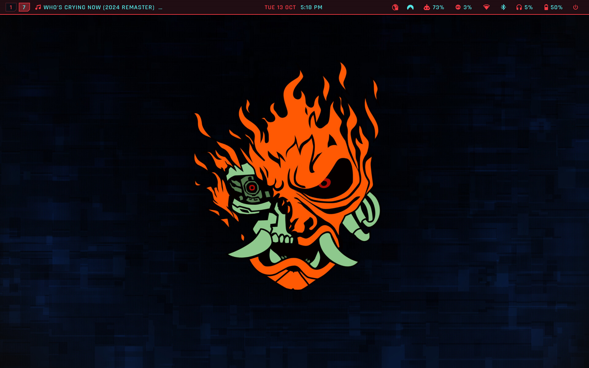
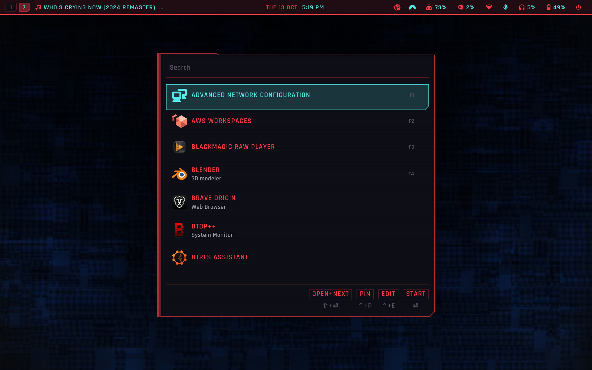
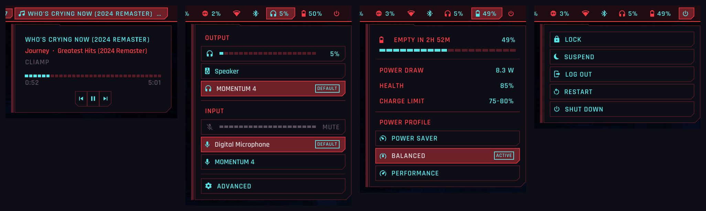
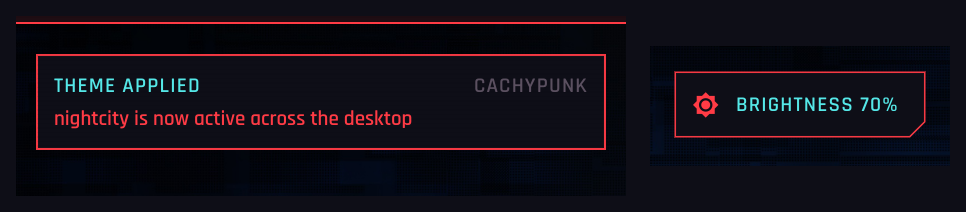
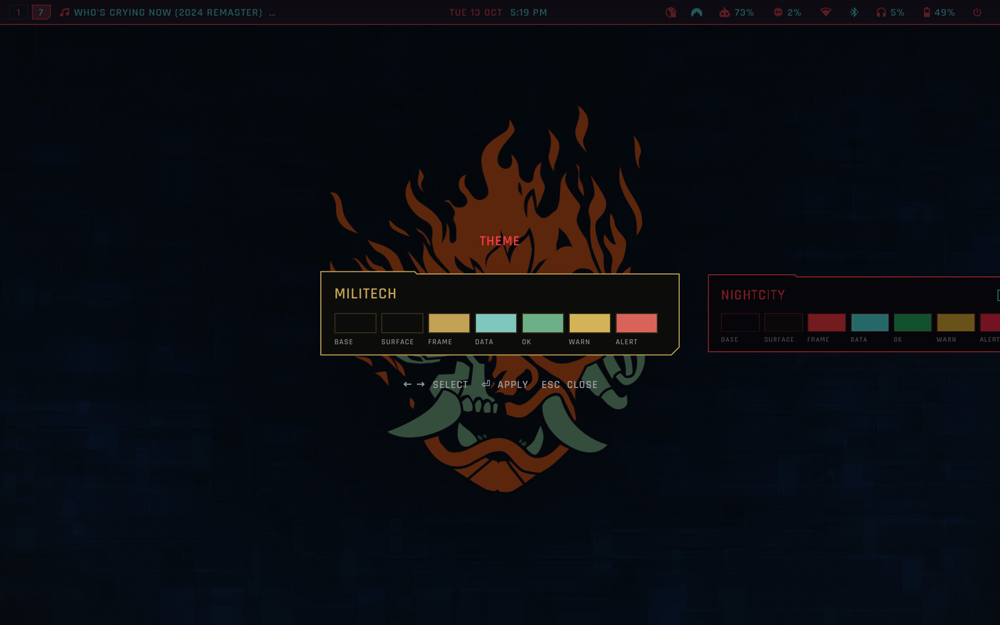

# Cachypunk

A Hyprland desktop styled after the menus of Cyberpunk 2077: square cards with
one 45° cut corner, a coral frame for labels, cyan for data, Rajdhani
everywhere. One palette drives every app, and the whole desktop installs and
updates from this repo.



What you get:

- **Quickshell** as the only shell: bar, keyboard-driven panels (network,
  bluetooth, audio, battery, media, power), OSD, notifications, the wallpaper
  and the polkit agent.
- **walker + elephant** as the launcher, clipboard, file search and emoji picker.
- **matugen** with fixed palettes (`nightcity`, `militech`): `theme-set <name>`
  re-renders Hyprland, Quickshell, walker, GTK 3/4, Qt 5/6, ghostty, Neovim,
  hyprlock, SDDM, the icon theme and more, then reloads what is running.
- An icon theme drawn from the same cards (folders and file types as labelled
  cards), a lock screen and login screen that match, and optionally sudo's
  fingerprint/password prompt redrawn as a panel in the terminal.

## Screenshots

**Launcher** (walker): the same card as every popup, at medium prominence.



**Panels**, one per bar segment, driven from the keyboard: media (`SUPER + M`),
audio, battery and power profiles, session.



**Notifications and OSD**, drawn by Quickshell as well.



**Theme switcher** (`SUPER + CTRL + T`): every theme previews in its own colours.



## Install

Arch Linux and derivatives (CachyOS, EndeavourOS...). Hyprland 0.55 or newer:
the config is Lua.

```sh
git clone https://github.com/X3R02/cachypunk ~/Projects/cachypunk
~/Projects/cachypunk/cachypunk install
```

The installer:

1. asks which optional modules you want (below);
2. installs the packages in `packages/` with paru or yay (it offers to build
   paru if you have neither);
3. symlinks every path in `links.txt` from `home/` into your `$HOME`.
   Anything already there is moved to `~/.local/state/cachypunk/backups/<date>/`
   first, never deleted;
4. writes the per-machine files (`~/.config/cachypunk/user.lua`, Qt configs),
   sets the GTK and icon theme, and applies the `nightcity` theme;
5. runs the optional modules' installers.

Then log in to Hyprland (or `hyprctl reload` if you are in it). `SUPER + K`
shows every keybinding.

### Optional modules

| Module | What it does | Root |
|---|---|---|
| `sddm` | the login screen, styled as the lock screen | yes |
| `sudo-panel` | sudo's fingerprint and password prompts as one panel that updates in place; replaces `/etc/pam.d/sudo` (the original is kept as `sudo.bak-auth-prompts`) | yes |
| `fingerprint` | fprintd, for sudo, polkit and hyprlock | no |
| `laptop` | TLP power management (replaces power-profiles-daemon) | yes |

Pick them non-interactively with `cachypunk install --modules sddm,laptop`.
The choice is saved in `~/.config/cachypunk/modules` and reused by `update`.

Before installing `sudo-panel`, keep a root shell open in another terminal
(`sudo -s`) until you have checked that `sudo true` still works.

## Keep it in sync

The repo *is* the config: `~/.config/hypr`, `~/.config/quickshell` and the rest
are symlinks into `home/`. Change something on one machine, commit and push
from the repo; on another machine:

```sh
cachypunk update    # git pull, then packages, links, theme and modules again
cachypunk status    # what is linked, what is missing, uncommitted changes
cachypunk link      # only (re)create the symlinks
```

Files that `theme-set` generates inside the linked folders (colours, rendered
CSS) are in `.gitignore`, so switching themes never shows up as a change.

## Your own settings

Nothing personal lives in the repo. Each machine keeps its own in
`~/.config/cachypunk/`, which updates never touch:

- `user.lua`: keyboard layouts, per-mouse settings, `$BROWSER`, the
  `SUPER + <letter>` app launchers and what starts with the session. See
  [`examples/user.lua`](examples/user.lua) for every field.
- `wallpapers/<theme>.jpg` (or `.png`): your image for that theme. Without one,
  `theme-set` draws a plain wallpaper from the palette.
- `modules`: the optional modules this machine uses.

## Themes

```sh
theme-set            # re-apply the current theme
theme-set militech   # switch
theme-set -l         # list
```

`SUPER + CTRL + T` opens the theme switcher. A theme is one JSON palette in
`home/.config/matugen/themes/`; the templates it feeds are in
`home/.config/matugen/templates/`, listed in `config.toml`.

## Design

Two documents decide how anything new should look:

- [`STYLEGUIDE.md`](home/.config/matugen/STYLEGUIDE.md): the game's own UI,
  colours by meaning, the official state opacities, shapes and components.
- [`DESIGN-SYSTEM.md`](home/.config/matugen/DESIGN-SYSTEM.md): how this
  desktop applies it: surfaces, components, states, prominence tiers and the
  rules every theme keeps.

## Layout

```
cachypunk          the installer and sync tool
links.txt          what gets symlinked into $HOME
home/              the config, mirrored onto $HOME
packages/          base.txt plus one list per optional module
templates/         files written per machine (Qt configs)
examples/user.lua  the per-machine settings, documented
```

## Credits and licences

- The code and config in this repo: MIT, see [LICENSE](LICENSE).
- Rajdhani (`home/.local/share/fonts/Rajdhani`): Indian Type Foundry, SIL Open
  Font License, see the `OFL.txt` next to it.
- `agent-usage` and its collectors are vendored from
  [Omarchy](https://github.com/omacom/omarchy) (MIT).
- The Neovim config starts from the LazyVim starter (Apache 2.0, see
  `home/.config/nvim/LICENSE`).
- Cyberpunk 2077 and its UI are CD PROJEKT RED's. This is a fan-made desktop
  theme; it ships none of their assets. The wallpaper in the screenshots is
  the author's own and is not included: a fresh install draws one from the
  palette, or uses yours from `~/.config/cachypunk/wallpapers/`.
